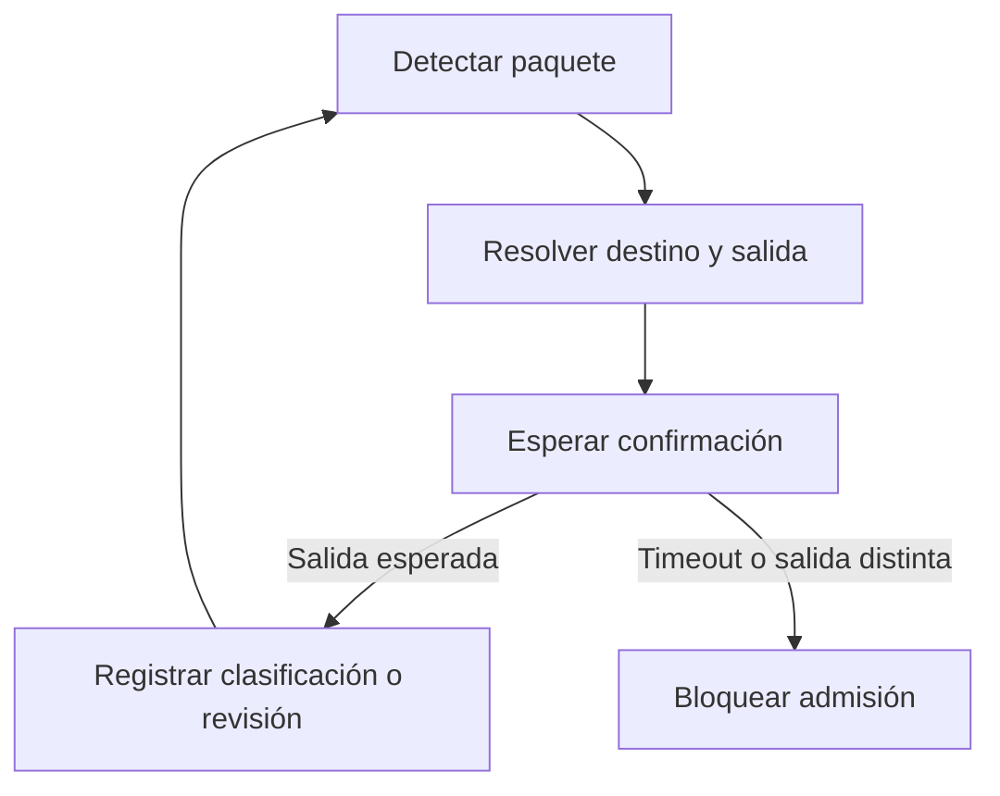

# Modelo de la estación simulada

| Requisito | Comportamiento | Verificación |
|---|---|---|
| SIM-01 | Obtener destino y salida a partir del ID del paquete | La demo confirma dos destinos distintos |
| SIM-02 | Enviar a revisión si el QR es ilegible, desconocido o carece de ruta | La prueba de revisión verifica las tres causas |
| SIM-03 | Confirmar clasificación al observar la salida esperada | La prueba de éxito valida la salida observada |
| SIM-04 | Bloquear admisión por timeout o salida incorrecta | La prueba de fallas comprueba que el paquete siguiente queda sin admitir |
| SIM-05 | Distinguir dos pasos del mismo paquete | La prueba de reprocesamiento compara los identificadores de intento |

El valor de salida observada es una entrada independiente de la ruta seleccionada. En la simulación, una observación ausente representa un timeout. En la estación física lo decidirán el sensor y el temporizador. Una revisión confirmada y un bloqueo por discrepancia son resultados distintos.
